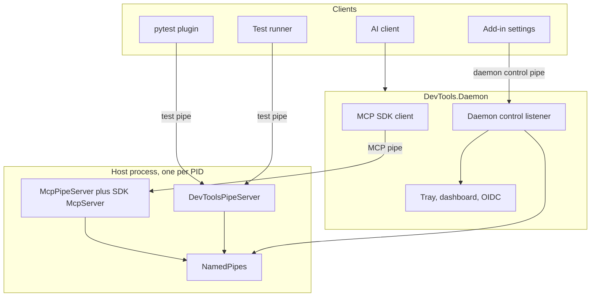
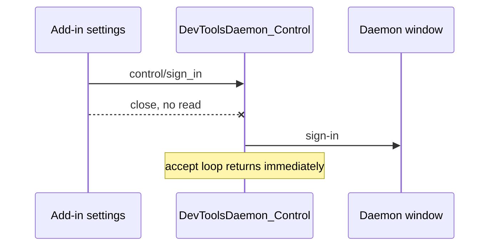

# IPC

Wiring for [0043](../../decisions/0043-ipc-shared-infrastructure-separate-protocols.md).
Host pipes: [MCP transport](../MCP/transport.md). Daemon commands:
[daemon](../MCP/daemon.md).

## Shape

`NamedPipes` creates each server. Three listeners stay. Each listener owns its stream.



With N host processes the machine has `2N + 1` listeners: an MCP pipe and a
test pipe in each host, plus one daemon control pipe. The name is the
address. The MCP pipe and the test pipe include a PID. The daemon control
pipe is one well-known name because there is one tray.

## DevTools.Ipc

`source/DevTools.Ipc/` owns the server factory and the test-pipe message format.

```text
source/DevTools.Ipc/
  NamedPipes.cs              create the server, current-user ACL
  HostPipeName.cs            test pipe and MCP pipe names
  BridgePipeConnection.cs    length-prefix frames for the test pipe
  BridgeMessage.cs           test-pipe message type
  IBridgeRequestHandler.cs   test-pipe method hook

Owners, outside DevTools.Ipc:
  DevTools.Mcp.Catalog/Transport/McpPipeServer.cs     MCP pipe session
  DevTools.Execution/External/DevToolsPipeServer.cs   test-pipe dispatch
  DevTools.Daemon/Control/ControlPipeHostedService.cs daemon control pipe
  DevTools.TestRunner/Services/TestPipeClient.cs      test-pipe client
  DevTools.Presentation/Services/DaemonClient.cs      daemon control client
```

The MCP pipe, the test pipe, and the daemon control pipe call `NamedPipes`.
Only the test pipe uses `BridgePipeConnection`. The SDK reads its own stream
from byte zero. The daemon control pipe reads one command line and has no reply.

## Daemon control pipe

The add-in writes `control/sign_in` and closes the stream. It does not
read. The accept loop does not wait for OAuth. Client close does not cancel
sign-in. Auth result stays on the Daemon window.



## Test pipe

`TestPipeClient` keeps one completion source per request id. A response
completes that id. A late or unknown id is dropped. The message format
(`testing/hello`, `testing/run`, `testing/cancel`, `testing/progress`,
`tests/run`, `ipytests/run`, `instance/info`) stays. The Python plugin is
another client of the same test pipe.

`DevToolsPipeServer` waits for each connection read loop on stop.
The message handler logs its own failure. Stop does not wait for a handler
inside host execution. A length below 1, a length above 16 MiB, or JSON that is
not a `BridgeMessage` raises a frame fault, then disconnect. A peer close
is disconnect only. Pipe disconnect does not cancel `IHostContextExecutor`
work while the host thread is in a breakpoint.

## Separate streams

| Listener | Why it has its own stream |
|----------|---------------------------|
| MCP pipe | `McpServer` owns the stream from the first byte. A handshake in front of it is a demux. |
| Test pipe | Pytest and the test runner connect with the Daemon stopped. Length-prefix frames are not JSON-RPC. |
| Daemon control pipe | Different process. One tray, not one per host PID. The host cannot show that window. |

`SendNotification` can write to every test-pipe connection. Each message
format keeps its own `JsonSerializerContext`.

Policy: [0043](../../decisions/0043-ipc-shared-infrastructure-separate-protocols.md).
