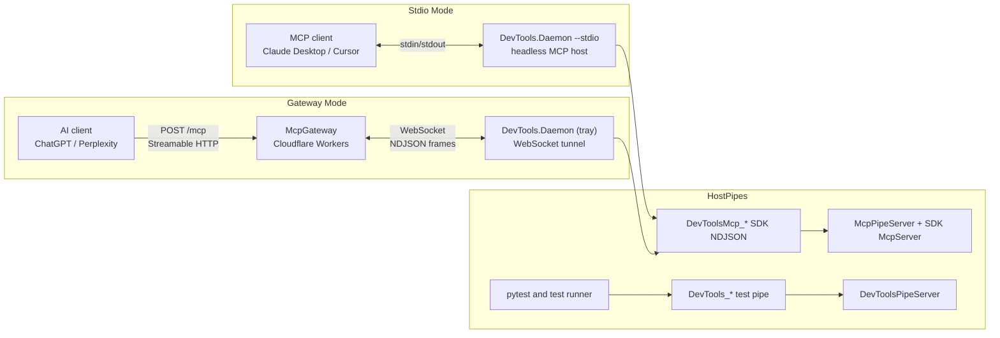

# Transport Modes

The Daemon supports two independent transport modes for external MCP clients.
Separately, each host listens on two pipes that must not be mixed.

| Mode | Trigger | Transport | Use case |
|------|---------|-----------|----------|
| **Stdio** | `--stdio` arg | Direct `StreamServerTransport` on process stdin/stdout | Local MCP clients |
| **Gateway** | Auto on sign-in (tray host only) | Outbound WebSocket to Cloudflare relay | Remote AI clients |

## Dual host pipes

| Pipe | Message format | Owner |
|------|----------------|-------|
| `DevTools_{Host}_{Version}_{PID}` | Length-prefixed `BridgeMessage` | `DevToolsPipeServer` |
| `DevToolsMcp_{Host}_{Version}_{PID}` | Newline-delimited JSON-RPC, MCP `2026-07-28` | `McpPipeServer` + per-connection `McpServer` |

The daemon control pipe is a third listener in the Daemon process. It has no reply.
See [0043](../../decisions/0043-ipc-shared-infrastructure-separate-protocols.md).

Do not multiplex SDK frames onto the test pipe (or the reverse).

## Stdio Mode

When an AI client spawns `DevTools.Daemon.exe --stdio`, a **new process** runs a self-contained MCP server on stdin/stdout. It boots its own `McpEngine`, `ProcessSessions`, and `DiscoveryHostedService` independently.

Key properties:
- Custom process entrypoint handles `--stdio` before the WPF tray starts.
- Bypasses the `SingleInstance` mutex.
- Discovers `DevToolsMcp_*` pipes independently.
- Auth tokens are read from the shared DPAPI file.
- Process exits when the MCP client disconnects.
- No control pipe, gateway tunnel, or tray icon in this mode.
- External tool/prompt surface is fixed (`ListChanged = false`).

## Gateway Mode

Outbound WebSocket connection to the McpGateway (Cloudflare Workers + Durable Objects):

1. `GatewayTunnelClient` connects to `wss://<gateway>/tunnel` with Bearer token
2. Sends `register` frame with `machine_id`, `machine_name`, `host_apps`
3. Wraps WebSocket frames as NDJSON streams via custom adapters
4. Runs full MCP server over that transport
5. Auto-reconnects with exponential backoff on failure
6. Sends periodic `heartbeat` frames with updated `host_apps`

## Multi-Machine Routing

One user can have Daemons on multiple machines connected to the same Gateway. The Gateway's Durable Object maintains a `Map<machine_id, WebSocket>`:

- **Register** → Daemon sends `machine_id` and `host_apps`. Every machine publishes the same tools, prompts, and resources
- **Connection requests** (`initialize`, notifications, `tools/list`) → any live machine. The gateway adds `list_machines` and a `machineId` argument to the `tools/list` result. Daemon tool methods do not take `machineId`
- **`list_machines`** → answered by the gateway from its live tunnels
- **`tools/call`** → gateway reads `arguments.machineId`, then removes it and forwards the call. One live machine needs no id. A missing or unknown id returns a tool result with `isError: true` and the live machines
- **Dynamic invoke** → `processId` inside `code_mode` belongs to the machine named by `machineId`
