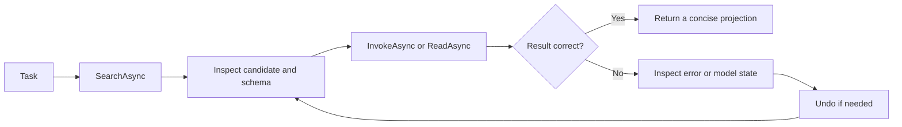

# MCP Workflow Patterns

Practical patterns for agents using RevitDevTool's fixed Daemon MCP surface.
Host tools are discovered and called from a C# program sent to `code_mode`.

## Search, inspect, and invoke

`SearchAsync` returns ranked candidates from the in-memory catalog. Choose a
candidate based on the task and its description; inspect its schema before
building arguments when necessary. Do not invoke the first result blindly.

```csharp
var candidates = await SearchAsync("find walls by category", processId: 80740);
var selected = candidates.First(match => match.Name == "revit_find_elements");
var tool = await DescribeAsync(selected.Name, selected.ProcessId);
return new { selected.Name, tool.InputSchema };
```

After checking the schema and arguments, call the capability inside the same
program:

```csharp
var arguments = new System.Collections.Generic.Dictionary<string, object?>();
// Populate arguments from tool.InputSchema before invoking.
return await InvokeAsync("revit_find_elements", arguments, processId: 80740);
```

`SearchAsync` and `DescribeAsync` use the Daemon catalog and do not open a host
pipe. `InvokeAsync` crosses the pipe to call a tool. Generic C# and Python
execution are fallback capabilities; use them when no suitable specialized
tool exists, or when execution is explicitly requested. See the search policy
in [decision 0040](../../decisions/0040-bm25f-search-and-hit-annotations.md).

## Read resources

Search with `primitiveType: "resource"` or `"resource_template"`, then call
`ReadAsync` with the selected name and process id. Resource reads do not use
`InvokeAsync`.

```csharp
var matches = await SearchAsync(
    "model context",
    processId: 80740,
    primitiveType: "resource");
return await ReadAsync(matches[0].Name, processId: matches[0].ProcessId);
```

## Verify and recover

Use `view_screenshot` to inspect visual results and `navigate_history` to undo
or redo host operations. Discover those host tools through `SearchAsync`, then
inspect and invoke them like other capabilities. Read `revit://model/context`
before model operations when current document state matters.



## Multiple host instances

Use `list_processes` to identify connected process ids. Pass `processId` to
`SearchAsync`, `DescribeAsync`, `InvokeAsync`, or `ReadAsync` when the target
host must be explicit. The Daemon does not add host tools to `tools/list`; the
external surface remains fixed.

## Related

- Product contract: [`docs/product/mcp.md`](../../product/mcp.md)
- Search behavior: [decision 0040](../../decisions/0040-bm25f-search-and-hit-annotations.md)
- Proposed hybrid-retrieval evaluation: [decision 0044](../../decisions/0044-hybrid-tool-retrieval.md)
- Daemon architecture: [README](README.md)
- In-host dispatch: [`docs/architecture/Execution/mcp-dispatch.md`](../Execution/mcp-dispatch.md)
