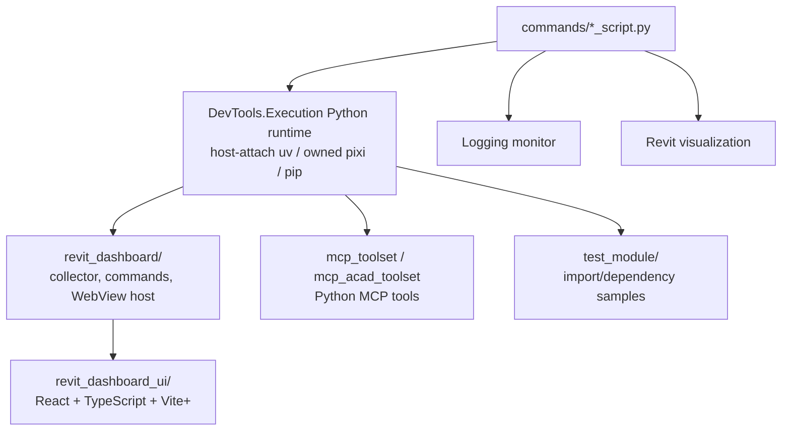

# PythonDemo Architecture

`samples/PythonDemo/` demonstrates the Python runtime, PEP 723 dependency resolution, logging, visualization, WebView2 dashboard patterns, and Python MCP toolsets.

Last updated: 2026-10-20

---

## Source Map

| Area | Path |
|------|------|
| Entry scripts | `samples/PythonDemo/commands/` |
| Dashboard backend | `samples/PythonDemo/revit_dashboard/` |
| Dashboard frontend | `samples/PythonDemo/revit_dashboard_ui/` |
| Python MCP toolset (Revit) | `samples/PythonDemo/mcp_toolset/` |
| Python MCP toolset (AutoCAD) | `samples/PythonDemo/mcp_acad_toolset/` |
| Import/dependency test module | `samples/PythonDemo/test_module/` |

---

## Component Map



---

## Entry Scripts

`commands/` contains the executable script entries discovered by `ScriptExecutionProvider`.

| Script | Purpose |
|--------|---------|
| `dashboard_ipy_script.py` | Launches the WebView2 dashboard on IronPython. |
| `data_analysis_script.py` | Polars/data-analysis demo. |
| `debugpy_script.py` | CPython `debugpy` demo (port 5678). |
| `debug_ipy_script.py` | IronPython debug demo (Revit, port 4567). |
| `debug_acad_ipy_script.py` | IronPython debug demo (AutoCAD, port 4567). |
| `export_data_script.py` | Excel export demo. |
| `fcl_script.py` | Geometry/collision dependency demo. |
| `logging_batch_script.py` | Logging stress sample. |
| `logging_format_script.py` | Logging format/severity sample. |
| `link_element_trace_script.py` | Pick linked elements; print `{instanceId}@{inner}` tokens for monitor click-to-select. |
| `modeless_script.py` | Modeless UI sample. |
| `module_test_script.py` | Multi-file import/dependency sample. |
| `pipe_bridge_script.py` | Named-pipe bridge sample. |
| `selectionfilter_script.py` | Revit API interface sample. |
| `shapely_script.py` | 2D geometry dependency sample. |
| `sklearn_script.py` | ML dependency sample. |
| `trimesh_script.py` | 3D mesh dependency sample. |
| `visualization_curve_script.py` | Revit curve visualization. |
| `visualization_solid_script.py` | Revit solid visualization. |
| `visualization_xyz_script.py` | Revit point visualization. |

---

## Dashboard Backend

`revit_dashboard/` is the IronPython package used by `dashboard_ipy_script.py`. It collects the open document and runs Revit commands. Charts, grouping, and the workbook are built in the page. The package does not import `RevitDevTool.Core` or a third-party Python package.

| Path | Role |
|------|------|
| `data/` | Collector, category registry, and raw warnings. |
| `revit_api/handler.py` | Revit API command bodies. One transaction per call. |
| `presentation/host.py` | Modeless WPF window and the Revit command queue. The page envelope is `pyrevit_webview.parse_request`, `response_message`, and `event_message`. |

`WebMessageReceived` only enqueues. `REVIT_CONTEXT.post` drains that queue on the Revit thread, one command per external event. `ColorOverride`, `Isolate`, and `ApplyGroupOverrides` keep the newest pending request. A replaced request is answered immediately so its promise settles. Replies go out through `ExecuteScriptAsync` as a `bim-bridge` event. `SaveWorkbook` shows the window Save dialog and writes the posted workbook bytes. `DEV_MODE` chooses the Vite server or `revit_dashboard_ui/dist/`.

---

## Dashboard Frontend

`revit_dashboard_ui/` is a Vite application.

| Technology | Current role |
|------------|--------------|
| React 19 | UI runtime |
| TypeScript | Type checking |
| Vite+ | Dev server and build (`vp`) |
| Semi UI | Controls, including the schedule table |
| ECharts | Charts |
| lucide-react | Icons |
| ExcelJS | Workbook built in the page |

The page filters, aggregates, and charts the snapshot. Product layout is `revit_dashboard_ui/design.md`.

From `revit_dashboard_ui/`:

```powershell
pnpm check
pnpm build
```

---

## Python MCP Toolset

Two Python MCP samples share the same layout (`tools/` → `services/` → `dto/` + `shared/`, plus `resources/` and `prompts/`). Entry files must match `*mcp.py` so `McpPathValidator` and PEP 723 pre-resolve can find them.

| Folder | Host | Entry |
|--------|------|-------|
| `mcp_toolset/` | Revit | `revitdevtool_mcp.py` |
| `mcp_acad_toolset/` | AutoCAD family | `acaddevtool_mcp.py` |

`mcp_toolset/` is the larger Revit-oriented catalog (query/CRUD/MEP/docs/export) plus parser samples (`tests/parser_annotation_sample.py`, `tests/parser_lowlevel_sample.py`).

`mcp_acad_toolset/` is a small AutoCAD catalog: status, layers, find/selection, draw line/circle, highlight, erase. Resources use `acad://…` URIs. Register it in AutoCAD's `AcadMcpRegistryConfig.json` (`pythonToolsetPaths`), not Revit's `McpRegistryConfig.json` — AutoCAD API imports fail in Revit.

Key folders (both toolsets):

- `tools/` - MCP tool functions grouped by domain (`acad_*` / `revit_*` names).
- `services/` - host API logic behind tools.
- `dto/` - DTO contracts.
- `shared/` - responses, annotations, transactions / document lock helpers.
- `resources/` / `prompts/` - static + live resources and workflow prompts.

---

## Test Module

`test_module/` demonstrates multi-file Python imports and plugin-style dependency structure. It is a sample for script dependency behavior, not a deep test suite.

---

## Related Docs

- `docs/architecture/Execution/README.md`
- `docs/architecture/MCP/README.md`
- `docs/architecture/Logging/README.md`
- `docs/architecture/Visualization/README.md`
