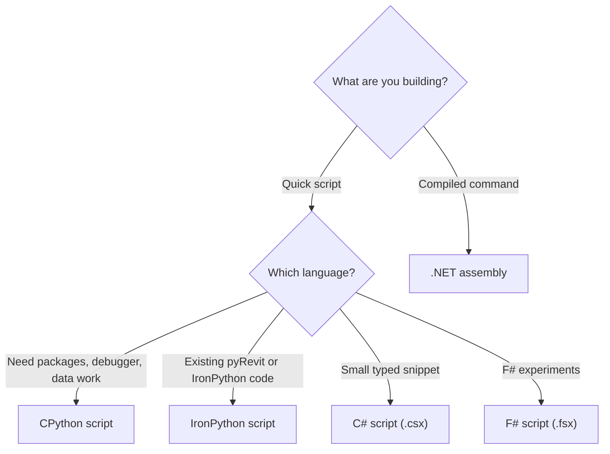

# Execution Overview

Use Execution when you want to run automation code inside the host without a slow rebuild/restart loop. Turn on the **Execution** toggle in the panel to see your scripts, then use **Load Scripts** or **Load .NET Assembly** to add sources.


Execution has two main user-facing paths:

| Path | Use when |
| --- | --- |
| Scripting | You want quick iteration from source files without creating a full add-in project |
| .NET Assembly | You want to run compiled commands from an add-in/tool assembly |

## Capability Table

What each runtime supports:

| Runtime | Entry suffix | Debugger | Packages / references | Hosts |
| --- | --- | --- | --- | --- |
| CPython | `*script.py` | **Yes** — attach your IDE (preferred port 5678) | **Pixi** (conda-forge + PyPI) default; pyRevit CPython engine fallback. **uv sidecar only on Plant 3D**, where the host already embeds CPython | Revit, AutoCAD, Civil 3D (CPython 3.14). Plant 3D uses its built-in CPython with uv — see [Modern Python Scripting](/docs/execution/python/Execution-Python) |
| IronPython | `*_ipy_script.py` | **Yes** — attach your IDE (preferred port 4567) | No PEP 723 / package manager | Revit + AutoCAD-family |
| C# script | `*script.csx` | **Yes** — attach to host process (VS / VS Code) | `#r "nuget: …"` via NuGet resolver | Revit + AutoCAD-family |
| F# script | `*script.fsx` | **Yes** — attach to host process (VS / VS Code) | `#r "nuget: …"`; cache `%APPDATA%\RevitDevTool\nuget` | Revit + AutoCAD-family |
| .NET assembly | `.dll` | **Yes** — attach to host process (VS / VS Code) | Compiled references | Revit + AutoCAD-family |

### IronPython engine selection

| Host | Engine |
| --- | --- |
| **Revit** | pyRevit engine first when pyRevit is loaded; embedded **IronPython 3.4.2** fallback |
| **AutoCAD-family** | Bundled **IronPython 3.4.2** (no pyRevit) |

IronPython execution and IronPython pytest routing (`test_*_ipy.py`) share the same Revit engine preference.

## Folder Rules

A folder is visible as a script command only if it contains at least one supported entry file:

```text
*script.py
*_ipy_script.py
*script.csx
*script.fsx
```

Build output, package folders, virtual environments, docs, and tooling folders are ignored.

## Choose The Right Mode



| Need | Recommended mode |
| --- | --- |
| Explore model data quickly | CPython scripting |
| Use pandas/polars/numpy/shapely-style packages | CPython scripting |
| Debug Python from VS Code or PyCharm | CPython scripting — [Debugging](/docs/execution/python/Execution-PythonDebugging) |
| Reuse IronPython or pyRevit-style code | IronPython scripting |
| Try a small typed snippet | C# script — [C# Scripts](/docs/execution/csharp-script/Execution-CSharp) |
| Prototype with F# interactive-style code | F# script — [F# Scripts](/docs/execution/fsharp-script/Execution-FSharp) |
| Run compiled commands without Add-In Manager | .NET assembly |
| Build a production add-in command | .NET assembly |

## Package manager

The **Execution** view lists the packages your scripts have resolved across all runtimes, grouped by source: NuGet, conda-forge and PyPI. A **Latest** badge marks the newest version in the cache.


Dependencies are declared in the script itself: see [Python Dependencies](/docs/execution/Python-Dependencies) and [NuGet Dependencies](/docs/execution/NuGet-Dependencies).

## Host Context Reminder

Host API calls must happen in valid host API context. Commands launched through RevitDevTool are designed for that workflow. Background/modeless UI code still needs to route host API work back through the supported host execution path.

## More Pages

- [Modern Python Scripting](/docs/execution/python/Execution-Python)
- [Attach Debugger](/docs/execution/python/Execution-PythonDebugging)
- [C# Scripts](/docs/execution/csharp-script/Execution-CSharp)
- [F# Scripts](/docs/execution/fsharp-script/Execution-FSharp)
- [.NET Assembly](/docs/execution/dotnet-assembly/Execution-Assembly)
- [Python Ecosystems](/docs/execution/python/Execution-PythonEcosystems)
- [IronPython — pyRevit Folder Compatibility](/docs/execution/ironpython/Execution-VsPyRevit)
