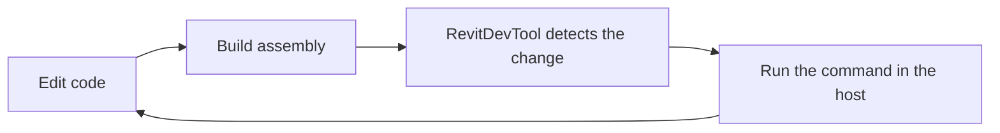

# .NET Assembly

.NET assembly execution is for compiled add-ins and commands.

Use it when you are developing a compiled command and want to run it from RevitDevTool during iteration.

In Revit, this fills the same practical role as Revit Add-In Manager: build a command assembly, load it, and run commands without packaging a full add-in workflow each time. For many development workflows, RevitDevTool can replace Add-In Manager while also giving you the surrounding logging, scripting, visualization, and tool workflow.

## Running the Assembly

In Revit, assembly execution is centered around Revit command contracts such as `IExternalCommand`. In AutoCAD-based products, commands are methods marked with `[CommandMethod]`.

Typical workflow:

1. Build a command assembly.
2. Add its folder to RevitDevTool settings.
3. Let the command tree discover the assembly.
4. Run the command from the panel or command browser.



## Debugging

Attach a .NET debugger to the running host process (`Revit.exe`, `acad.exe`, …), set breakpoints in your compiled source, then run the command from RevitDevTool.

| IDE | Workflow |
| --- | --- |
| **Visual Studio** | Debug → Attach to Process → select host → Run command |
| **VS Code** | C# Dev Kit → Attach to Process → select host → Run command |

For shared attach guidance (including C# and F# scripts), see [Attach Debugger](/docs/execution/python/Execution-PythonDebugging).

## Version Notes

| Autodesk version | Runtime behavior |
| --- | --- |
| 2022-2024 | .NET Framework (`net48`); loaded assemblies cannot be unloaded, so restart the host to release one |
| 2025-2026 | .NET 8; assemblies can be unloaded and reloaded |
| 2027 | .NET 10; same as 2025-2026 |

## Example

Build the command as a class library for your Autodesk year, then add the output folder in RevitDevTool settings.

### Revit

A Revit command implements `IExternalCommand`:

```csharp title="BoundingBoxCommand.cs"
using System.Diagnostics;
using Autodesk.Revit.Attributes;
using Autodesk.Revit.DB;
using Autodesk.Revit.UI;
using Autodesk.Revit.UI.Selection;

[Transaction(TransactionMode.Manual)]
public class BoundingBoxCommand : IExternalCommand
{
    public Result Execute(ExternalCommandData commandData, ref string message, ElementSet elements)
    {
        var uidoc = commandData.Application.ActiveUIDocument;
        var reference = uidoc.Selection.PickObject(ObjectType.Element);
        var element = uidoc.Document.GetElement(reference);

        Trace.Write(element.get_BoundingBox(null));
        return Result.Succeeded;
    }
}
```

### AutoCAD

An AutoCAD-based command (AutoCAD, Civil 3D, Plant 3D) is a static method marked with `[CommandMethod]`. This one lists the layers of the active drawing:

```csharp title="LayerCommands.cs"
using System.Diagnostics;
using Autodesk.AutoCAD.ApplicationServices.Core;
using Autodesk.AutoCAD.DatabaseServices;
using Autodesk.AutoCAD.Runtime;

public static class LayerCommands
{
    [CommandMethod("ListLayers")]
    public static void ListLayers()
    {
        var doc = Application.DocumentManager.MdiActiveDocument;
        if (doc == null) return;

        using var tr = doc.TransactionManager.StartTransaction();
        var layers = (LayerTable)tr.GetObject(doc.Database.LayerTableId, OpenMode.ForRead);

        foreach (var layerId in layers)
        {
            var layer = (LayerTableRecord)tr.GetObject(layerId, OpenMode.ForRead);
            var status = layer.IsFrozen ? " [Frozen]" : layer.IsOff ? " [Off]" : "";
            Trace.TraceInformation($"{layer.Name}{status} | Color: {layer.Color}");
        }

        tr.Commit();
    }
}
```

:::tip See the output
`Trace` output appears in the RevitDevTool Trace panel on both hosts, so you can use the same logging in Revit and AutoCAD commands.
:::

## Samples

- [`CSharpDemo`](https://github.com/trgiangv/RevitDevTool/tree/main/samples/CSharpDemo): Revit commands that trace geometry for visualization
- [`AcadCSharpDemo`](https://github.com/trgiangv/RevitDevTool/tree/main/samples/AcadCSharpDemo): AutoCAD commands for selection, document info and layers

## User Guidance

When building external assemblies:

- target the correct Autodesk year/runtime;
- keep host API references aligned with the target year;
- test against the actual host when command behavior depends on host API context.

For package references and conflicts with host assemblies, see [NuGet Dependencies](/docs/execution/NuGet-Dependencies). For build commands, see [Build From Source](/docs/getting-started/Build-From-Source).

## Related

- [Execution Overview](/docs/execution/Execution-Overview)
- [Attach Debugger](/docs/execution/python/Execution-PythonDebugging)
- [C# Scripts](/docs/execution/csharp-script/Execution-CSharp)
