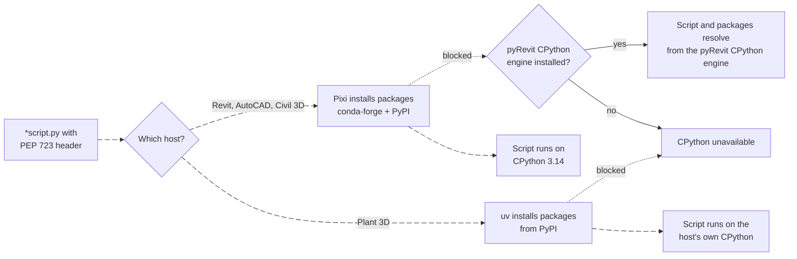

# Modern Python Scripting

Use CPython scripting when you want fast automation, data extraction, computational geometry, reporting, debugger support, or package-heavy workflows inside the host.

This page covers the modern CPython path: PythonNet in-process with CAD/BIM hosts. For IronPython, C#/F# scripts, and assemblies, see [Execution Overview](/docs/execution/Execution-Overview).

<LogoRow items={['python', 'pixi', 'conda-forge', 'pypi', 'uv', 'pyrevit']} />

## How a script runs



## Python runtime by host

| Host | Python | Packages |
| --- | --- | --- |
| **Revit**, **AutoCAD**, **Civil 3D** | CPython 3.14, installed by RevitDevTool | Pixi: conda-forge and PyPI |
| **Plant 3D** | The CPython built into the host, so the version follows the host (Plant 3D 2027 uses 3.13) | uv: PyPI only |

:::info Other AutoCAD products
Architecture, MEP, Electrical, Mechanical and Map 3D follow the AutoCAD path. See [Host settings](/docs/testing/Testing-Overview#host-settings) for the `host_name` values.
:::

### Revit, AutoCAD, Civil 3D

CPython 3.14 runs in the host process. The environment lives in `%APPDATA%\RevitDevTool\pixi-env`, and PEP 723 packages install through **Pixi**.

### Plant 3D

Plant 3D already embeds CPython, so RevitDevTool uses that interpreter instead of starting a second one. Packages install with **uv** from PyPI into `%APPDATA%\RevitDevTool\uv-env\{major.minor}`, matching the host's Python version.

:::warning Match the host's Python
On Plant 3D, choose packages that publish wheels for the host's CPython version and ABI. A package that only supports a newer Python, or is available only on conda-forge, will not install.
:::

### pyRevit CPython engine

If Pixi cannot run, RevitDevTool falls back to the CPython engine installed by pyRevit. The script and its packages are resolved from that engine, so the Python version is whatever pyRevit provides.

:::info When Pixi or uv cannot run
This is usually company policy blocking the executable, not a problem with your script. If your company allows pyRevit, RevitDevTool falls back to its CPython engine. Otherwise ask IT to allow Pixi. Plant 3D has no fallback and needs uv. See [Known Limitations](/docs/getting-started/Known-Limitations).
:::

pyRevit also controls its own IronPython engine for `*_ipy_script.py` scripts, which is a separate path described in [IronPython — pyRevit Engine](/docs/execution/ironpython/Execution-VsPyRevit).

## Entry File

CPython script folders are discovered through files ending with:

```text
*script.py
```

A complete script looks like this:

```python title="walls_script.py"
# /// script
# dependencies = ["polars"]
# ///

import polars as pl
from Autodesk.Revit import DB

doc = __revit__.ActiveUIDocument.Document
walls = DB.FilteredElementCollector(doc).OfClass(DB.Wall)

print(pl.DataFrame({"name": [w.Name for w in walls]}))
```

More complete scripts, such as [`data_analysis_script.py`](https://github.com/trgiangv/RevitDevTool/blob/main/samples/PythonDemo/commands/data_analysis_script.py), are in [PythonDemo/commands](https://github.com/trgiangv/RevitDevTool/tree/main/samples/PythonDemo/commands) on GitHub.

## Dependency Metadata

Dependencies are declared with PEP 723 metadata in the script file:

```python
# /// script
# dependencies = ["polars", "numpy"]
# ///
```

The runtime parses metadata before execution and prepares the environment with **Pixi** on every host except Plant 3D, which uses the **uv sidecar**.

## Host Context

### Revit

Scripts receive `__revit__` (`UIApplication`) and a shared state namespace on `sys.__devtool__` for scope-local RevitDevTool state.

### AutoCAD family

There is no `__revit__`. Use the host `Application` API instead. See [AutoCAD Features](/docs/hosts/Hosts-AutoCAD) for the AutoCAD host context pattern.

For modeless UI or background work in any host, route host API calls through the supported host execution path.

## Debugging

Attach your IDE (VS Code or PyCharm) to the debug port, then run the script from RevitDevTool.

For the full workflow, port settings, .NET attach for scripts/assemblies, and troubleshooting, see [Attach Debugger](/docs/execution/python/Execution-PythonDebugging).

## IronPython vs CPython Conventions

These suffixes serve different purposes — do not mix them:

| Purpose | Entry suffix | Notes |
| --- | --- | --- |
| Run IronPython automation | `*_ipy_script.py` | Attach your IDE to the IronPython port — [Attach Debugger](/docs/execution/python/Execution-PythonDebugging) |
| Test IronPython in-host | `test_*_ipy.py` | pytest routing only; same Revit engine preference — [unittest](/docs/testing/unittest) |

`*_ipy_script.py` is for commands you run from RevitDevTool. `test_*_ipy.py` is how the pytest plugin routes IronPython unittest files to the host — it is not an execution entry name.

## Examples

All samples live in [`PythonDemo/commands`](https://github.com/trgiangv/RevitDevTool/tree/main/samples/PythonDemo/commands). Good places to start:

| Script | Shows |
| --- | --- |
| [`data_analysis_script.py`](https://github.com/trgiangv/RevitDevTool/blob/main/samples/PythonDemo/commands/data_analysis_script.py) | Collect model data and analyze it with Polars |
| [`debugpy_script.py`](https://github.com/trgiangv/RevitDevTool/blob/main/samples/PythonDemo/commands/debugpy_script.py) | Debug a script from your IDE |
| [`selectionfilter_script.py`](https://github.com/trgiangv/RevitDevTool/blob/main/samples/PythonDemo/commands/selectionfilter_script.py) | Selection filters |
| [`visualization_curve_script.py`](https://github.com/trgiangv/RevitDevTool/blob/main/samples/PythonDemo/commands/visualization_curve_script.py) | Draw curves in the active view |
| [`logging_format_script.py`](https://github.com/trgiangv/RevitDevTool/blob/main/samples/PythonDemo/commands/logging_format_script.py) | Log levels, JSON and stack traces |
| [`modeless_script.py`](https://github.com/trgiangv/RevitDevTool/blob/main/samples/PythonDemo/commands/modeless_script.py) | Modeless windows |
| [`dashboard_ipy_script.py`](https://github.com/trgiangv/RevitDevTool/blob/main/samples/PythonDemo/commands/dashboard_ipy_script.py) | An IronPython dashboard with WebView2 |

## Caveats

- Package installation can be blocked by local policy, a missing `pixi` executable (or `uv` on Plant 3D, which has no fallback), or network access.
- On Plant 3D, host-owned attach cannot load conda `Library\bin` activation or a second in-process Python layout — prefer PyPI wheels with private native deps.
- Host API calls still require valid host context.
- PythonNet behavior differs from IronPython, especially around .NET interop.

## Related

- [Attach Debugger](/docs/execution/python/Execution-PythonDebugging)
- [Execution Overview](/docs/execution/Execution-Overview)
- [Python Ecosystems](/docs/execution/python/Execution-PythonEcosystems)
- [IronPython — pyRevit Folder Compatibility](/docs/execution/ironpython/Execution-VsPyRevit)
