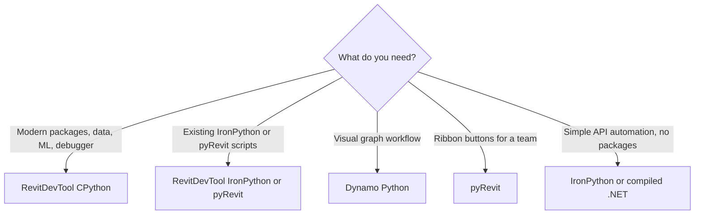

# Python Ecosystems For Revit

Python in Revit has several runtime options. Choose based on what you need: modern packages, direct .NET compatibility, visual programming, or team deployment. RevitDevTool runs on Revit and the AutoCAD family.

<LogoRow items={['python', 'ironpython', 'pyrevit', 'dynamo', 'dotnet']} />

## Quick Choice



## Runtime Comparison

| Runtime | Best for | Strengths | Tradeoffs |
| --- | --- | --- | --- |
| RevitDevTool CPython | package-heavy development | modern Python, PEP 723 dependencies, `debugpy` debugging | uses Python.NET for .NET interop |
| RevitDevTool IronPython | IronPython scripts and existing pyRevit or RevitPythonShell code | On Revit, uses the pyRevit engine when installed, else IronPython 3.4.2; AutoCAD family uses bundled 3.4.2 | IDE debugger attach (VS Code, PyCharm); no modern CPython packages |
| pyRevit IronPython | ribbon automation and team scripts | mature extension model, direct CLR style | older Python ecosystem |
| pyRevit CPython | experimentation | CPython inside the pyRevit ecosystem | setup-dependent caveats |
| Dynamo CPython | graph + Python workflows | visual programming, bundled packages | less suited to code-first debugging |
| Compiled .NET | production add-ins | strong typing, host-native API, attach debugger | slower iteration than scripts |

## RevitDevTool CPython

Use it for new Python work when packages matter. Good fits: model data extraction, dataframe analysis, Excel and report generation, geometry processing, research and AI/ML experiments, and scripts that benefit from IDE debugging.

```python
# /// script
# dependencies = [
#     "polars==1.38.1",
#     "numpy==2.4.2",
#     "openpyxl==3.1.5",
# ]
# ///
```

| Host | Python source | Package manager |
| --- | --- | --- |
| Revit, AutoCAD, Civil 3D | CPython 3.14 installed with Pixi in `%APPDATA%\RevitDevTool\pixi-env` | Pixi (conda-forge + PyPI); pyRevit CPython engine as fallback |
| Plant 3D | The CPython that Plant 3D ships, so the version follows the host (3.13 on Plant 3D 2027) | uv from PyPI, into `%APPDATA%\RevitDevTool\uv-env\{major.minor}` |

See [Modern Python Scripting](/docs/execution/python/Execution-Python) for how a script runs on each host.

## IronPython

Use IronPython when IronPython or .NET behavior matters more than modern CPython packages. Good fits: existing pyRevit or RevitPythonShell scripts, simple Revit API automation, and workflows that do not need NumPy, pandas, Polars, Shapely or similar packages.

On Revit, IronPython **scripts** (`*_ipy_script.py`) and IronPython **tests** (`test_*_ipy.py`) both prefer the pyRevit engine when it is installed. pyRevit decides which engine and version it runs. Without pyRevit, RevitDevTool falls back to IronPython 3.4.2. AutoCAD-family hosts use bundled IronPython 3.4.2.

IronPython can be debugged from your IDE just like CPython, on its own port. See [Attach Debugger](/docs/execution/python/Execution-PythonDebugging).

## Dynamo Python

Use Dynamo Python when the surrounding workflow is a Dynamo graph: visual programming, graph-controlled inputs and outputs, the Dynamo package ecosystem, and designers who prefer node graphs.

## pyRevit

Use pyRevit when the main goal is distributing buttons and automations to users: team ribbon tools, established pyRevit extensions and reusable buttons.

RevitDevTool works beside pyRevit for development, package experiments, and IronPython/CPython compatibility. It also falls back to pyRevit's CPython engine when Pixi cannot run.

## .NET Interop Notes

CPython talks to .NET APIs through Python.NET. You get modern Python packages, but interop is not identical to IronPython. Watch for:

- .NET interface implementation differences;
- overload resolution;
- extension methods;
- `out` / `ref` style APIs;
- dynamic object behavior inside the debugger.

For pure Revit API automation with heavy .NET interop and no Python packages, IronPython or compiled .NET may be simpler. For package-heavy work, CPython is usually the better choice.

## Related

- [Data Analysis example](/docs/examples/Examples-DataAnalysis)
- [Dashboard example](/docs/examples/Examples-Dashboard)
- [Visualization Curves example](/docs/examples/Examples-VisualizationCurves)
- [Attach Debugger](/docs/execution/python/Execution-PythonDebugging)
- [IronPython — pyRevit Folder Compatibility](/docs/execution/ironpython/Execution-VsPyRevit)
