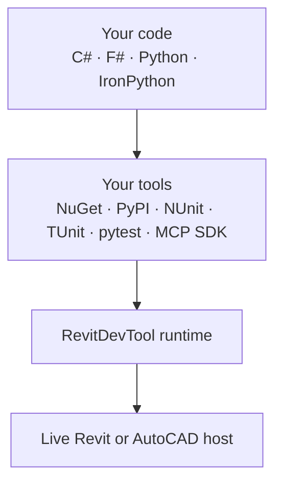

# Overview

RevitDevTool brings standard development ecosystems into live CAD/BIM hosts without replacing them.

Use the languages, package managers, test frameworks, and AI protocols you already know:

It is the development platform for BIM and CAD: execution, debugging, testing, visualization and AI integration, currently on Revit, AutoCAD, Civil 3D and Plant 3D.

import Tabs from '@theme/Tabs';
import TabItem from '@theme/TabItem';

<Tabs groupId="host" defaultValue="revit">
<TabItem value="revit" label="Revit">

</TabItem>
<TabItem value="civil3d" label="Civil 3D">

</TabItem>
</Tabs>

The panel docks beside your model and streams logs from every run. Three toggles at its top switch the view below the log:

| Toggle | Shows |
| --- | --- |
| **Execution** | Your scripts and assemblies, the package manager, and the debug ports. Use **Load Scripts** and **Load .NET Assembly** to add sources |
| **MCP** | Every tool the host offers to AI clients. Use **Load .NET Toolset** and **Load Python Toolset** to add toolsets |
| **Settings** | General, Visualization, MCP and Log settings |

Geometry you trace is previewed in the active Revit view.

## Choose a path

- [Install RevitDevTool and run your first script](getting-started/installation)
- [Run scripts and add-ins](execution/Execution-Overview) in Python, IronPython, C#, F# or .NET assemblies
- [Resolve Python dependencies inline](execution/Python-Dependencies)
- [Run tests inside a live host](testing/Testing-Overview)
- [Connect an AI client](mcp/MCP-Protocol) through MCP
- [Browse the examples](examples/Examples-Overview)
