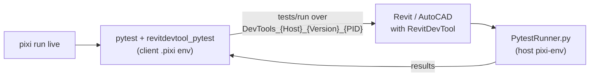

# Develop the pytest client

How to change and test `revitdevtool_pytest` from this repository. To use the package in your own tests, see [pytest](/docs/testing/pytest).

## Three Pixi workspaces

The repository has three [Pixi](https://pixi.sh) workspaces. Each one makes a different Python environment.

| Manifest | Environment | Used for |
| --- | --- | --- |
| `source/RevitDevTool.PyTest/pyproject.toml` | `source/RevitDevTool.PyTest/.pixi` | Developing the client: Python 3.14 (the host version), ruff, build, and the package installed editable |
| `source/DevTools.Execution/Resources/scripts/pixi.toml` | `%APPDATA%\RevitDevTool\pixi-env` | The CPython inside Revit or AutoCAD: Python 3.14, pytest, debugpy. RevitDevTool copies this manifest on first use |
| `pixi.toml` (repository root) | `.pixi` at the root | Repository scripts, and the `release` environment that runs git-cliff for changelogs |

The client package has one manifest. `pyproject.toml` holds both parts:

- `[project]` is the package that PyPI receives: name, version, dependencies, and the `pytest11` entry point.
- `[tool.pixi.*]` is the development environment and its tasks. Pixi reads it from `pyproject.toml`, so there is no separate `pixi.toml`.

## How a run flows



1. Pytest collects the tests in the client environment.
2. The plugin finds the host pipe, or starts the host when `force_launch` is on.
3. The host adds any PEP 723 dependencies of the tests to its own `pixi-env`, then runs them with `PytestRunner.py`.
4. The results return to the client, and pytest reports them as usual.

The client and the host use separate environments. A package that the tests import inside the host goes in a PEP 723 block or in `conftest.py`, not in the client `pyproject.toml`.

## Test locally

Prerequisites: [Pixi](https://pixi.sh) on `PATH`. The live suite also needs Revit (or Civil 3D) with RevitDevTool loaded.

Run these from `source/RevitDevTool.PyTest`:

```powershell title="Terminal"
pixi install                                   # create the client environment
pixi run lint                                  # ruff check + format check
pixi run test                                  # unit and golden wire tests, no host
pixi run build                                 # wheel and sdist into dist/
```

These need no host. `pixi run test` also checks the golden wire fixtures in `tests/golden`, the same files the C# `GoldenWireTests` read. A change to the wire must pass on both sides.

### Live suite

`pixi run live` runs the tests in `tests/Revit` against a real host. Its settings are in `tests/live.ini`:

| Setting | Default | Change it to |
| --- | --- | --- |
| `testpaths`, `pythonpath` | `tests/Revit` | `tests/Civil3d` for Civil 3D |
| `host_name`, `host_version` | `revit`, `2025` | The host you have installed |
| `force_launch` | `false` | `true` to start the host when none is running |

```powershell title="Terminal"
pixi run live -v
pixi run live tests/Revit/test_smoke.py -v
pixi run live --host-version=2026 -v
```

Set `REVIT_TEST_MODEL_PATH` to the `.rvt` file the `revit_doc` fixture opens.

### When the host side changes

The host side of the bridge is C# (`DevTools.Execution`) and `PytestRunner.py`. After changing it:

1. Build and deploy the add-in for the year you test: `scripts/build-host.ps1 -HostApp Revit -Year 2025`.
2. Restart the host, then run `pixi run live`.
3. Run the C# side of the wire: `dotnet run --project tests/DevTools.Execution.Pytest.Tests`.

### Same checks as CI

From the repository root:

```powershell title="Terminal"
dotnet run --project build -- ci pytest        # lint and test, as ci.yml runs them
dotnet run --project build -- pack pytest      # wheel and sdist at a 0.0.0.dev version into output/pytest
```

Releases follow the `pytest` product in the release runbook (`docs/agents/release.md`).

## Troubleshooting

| Symptom | Check |
| --- | --- |
| `pixi` is not found | Install Pixi and open a new terminal |
| `pixi run test` imports an old copy of the package | Run `pixi install` again; the package is installed editable from `src/` |
| Live run finds no host | Start the host with RevitDevTool loaded, set `force_launch = true`, or check `host_version` in `tests/live.ini` |
| A test fails to import a package inside the host | Declare it in the test's PEP 723 block or in `conftest.py`; the client environment does not reach the host |
